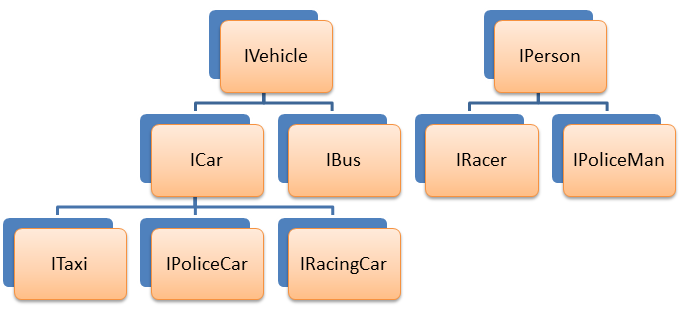
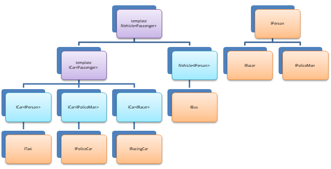
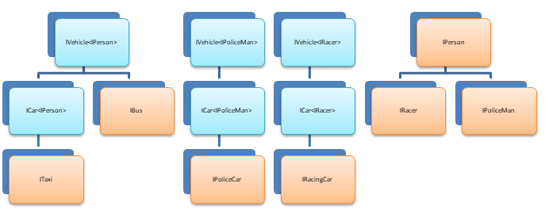
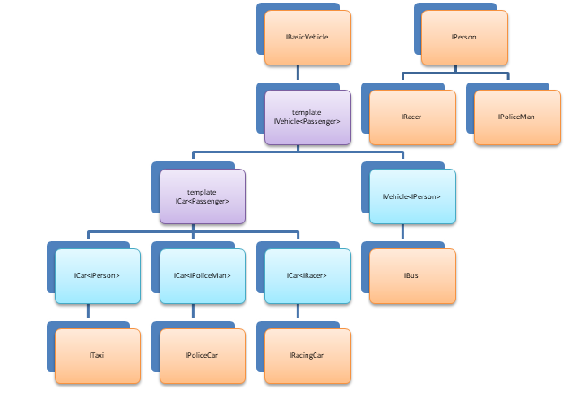
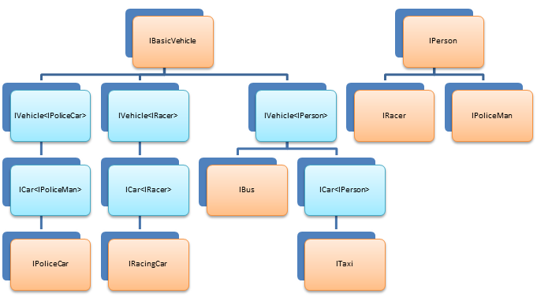
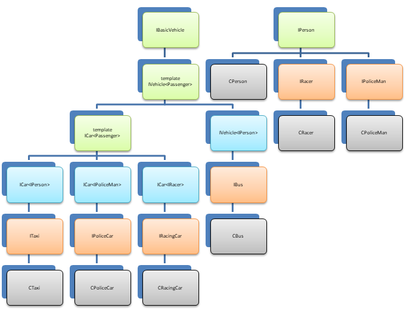
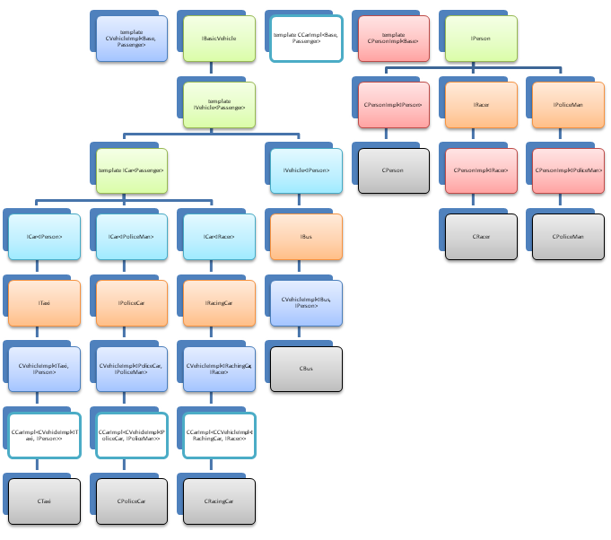

#### Вариант 2. 120 баллов - Vehicle

Различные виды транспорта могут перевозить различные типы пассажиров – автобусы и такси – всех людей, полицейские автомобили – полицейских, гоночные машины – гонщиков.

Имеется следующая изначальная иерархия типов транспортных средств и пассажиров:



```c++
// человек
class IPerson
{
public:
    // имя
    virtual std::string GetName()const = 0;
};

// полицейский
class IPoliceMan : public IPerson
{
public:
    // название полицейского департамента
    virtual std::string GetDepartmentName()const = 0;
};

// гонщик
class IRacer : public IPerson
{
public:
    // количество наград
    virtual size_t GetAwardsCount()const = 0;
};
```

Нам нужен механизм, позволяющий размещать в определенных видах транспорта соответствующие типы пассажиров. Например, в такси или автобус мы должны иметь возможность разместить любых людей (включая гонщиков и полицейских), в полицейскую машину – только полицейских, а в гоночную – только гонщиков.

Можно было бы спроектировать следующие классы транспортных средств:

```c++
class IVehicle
{
};

class ICar : public IVehicle
{
};

class IRacingCar : public ICar
{
public:
    virtual void AddRacer(boost::shared_ptr<IRacer> pRacer) = 0;
};

class IPoliceCar : public ICar
{
public:
    virtual void AddPoliceMan(boost::shared_ptr<IPoliceMan> pPoliceMan) = 0;
};

class ITaxi : public ICar
{
public:
    virtual void AddPassenger(boost::shared_ptr<IPerson> pPerson) = 0;
};

class IBus : public IVehicle
{
public:
    virtual void AddPassenger(boost::shared_ptr<IPerson> pPerson) = 0;
};
```

Очевидно, что такое решение приведет нас к тому, реализация методов посадки нужного типа человека в транспортное средство будет во всех классах одинаковой. Поэтому лучше сделать интерфейсы `IVehicle` и `ICar` шаблонными, где в качестве параметра шаблона будет выступать тип людей, которые возможно на данном типе транспорта перевозить.

Интерфейсы «такси», «полицейский автомобиль», «гоночный автомобиль» и «автобус» будут образованы при помощи наследования от шаблонных классов «автомобиль» и «транспорт».

Обновленная иерархия:



Фактически во время компиляции на этапе инстанцирования шаблонов компилятором будет построена следующая иерархия (произойдет «расщепление» базового шаблонного класса `IVehicle`):



Исходный код получившейся иерархии (В класс `IVehicle` были добавлены несколько методов):

```c++
template <typename Passenger>
class IVehicle
{
public:
    // сигнализирует о том, пусто ли транспортное средство
    virtual bool IsEmpty()const = 0;

    // сигнализирует о том заполнено ли транспортное средство полностью
    virtual bool IsFull()const = 0;

    // возвращает общее количество мест
    virtual size_t GetPlaceCount()const = 0;

    // возвращает количество пассажиров на борту
    virtual size_t GetPassengerCount()const = 0;

    // высаживает всех пассажиров
    virtual void RemoveAllPassengers() = 0;

    // добавить пассажира на борт
    // т.к. пассажир может быть полиморфным типом, принимаем его по умному указателю
    // Если нет места, выбрасывается исключение std::logic_error
    virtual void AddPassenger(boost::shared_ptr<Passenger> pPassenger) = 0;

    // Получить ссылку на пассажира с заданным индексом
    // выбрасывает исключение std::out_of_range в случае недопустимого индекса
    virtual Passenger const& GetPassenger(size_t index)const = 0;

    // убрать пассажира с заданным индексом
    // выбрасывает исключение std::out_of_range в случае недопустимого индекса
    virtual void RemovePassenger(size_t index) = 0;
};

template <typename Passenger>
class ICar : public IVehicle<Passenger>
{
};

class IRacingCar : public ICar<IRacer>
{
public:
};

class IPoliceCar : public ICar<IPoliceMan>
{
public:
};

class ITaxi : public ICar<IPerson>
{
public:
};

class IBus : public IVehicle<IPerson>
{
public:
};
```

Проанализировав класс `IVehicle` мы приходим к выводу, что часть методов данного класса не зависит от типа пассажиров:

```c++
    // сигнализирует о том, пусто ли транспортное средство
    virtual bool IsEmpty()const = 0;

    // сигнализирует о том заполнено ли транспортное средство полностью
    virtual bool IsFull()const = 0;

    // возвращает общее количество мест
    virtual size_t GetPlaceCount()const = 0;

    // возвращает количество пассажиров на борту
    virtual size_t GetPassengerCount()const = 0;

    // высаживает всех пассажиров
    virtual void RemoveAllPassengers() = 0;
```

Данные методы можно выделить в базовый нешаблонный интерфейс `IBasicVehicle`, не зависящий от типа пассажиров.

Обновленная иерархия будет выглядеть следующим образом:



На этапе инстанцирования шаблонов из нее будет построена следующая:



Исходный код обновленной иерархии интерфейсов (в классы ряда транспортных средств добавлены методы, специфичные для данного типа транспортных средств):

```c++
// базовое транспортное средство
class IBasicVehicle
{
public:
    // сигнализирует о том, пусто ли транспортное средство
    virtual bool IsEmpty()const = 0;

    // сигнализирует о том заполнено ли транспортное средство полностью
    virtual bool IsFull()const = 0;

    // возвращает общее количество мест
    virtual size_t GetPlaceCount()const = 0;

    // возвращает количество пассажиров на борту
    virtual size_t GetPassengerCount()const = 0;

    // высаживает всех пассажиров
    virtual void RemoveAllPassengers() = 0;
};

// транспортное средство предназначенное для провозки заданного типа пассажиров
template <typename Passenger>
class IVehicle : public IBasicVehicle
{
public:
    // добавить пассажира на борт
    // т.к. пассажир может быть полиморфным типом, принимаем его по умному указателю
    // Если нет места, выбрасывается исключение std::logic_error
    virtual void AddPassenger(boost::shared_ptr<Passenger> pPassenger) = 0;

    // Получить ссылку на пассажира с заданным индексом
    // выбрасывает исключение std::out_of_range в случае недопустимого индекса
    virtual Passenger const& GetPassenger(size_t index)const = 0;

    // убрать пассажира с заданным индексом
    // выбрасывает исключение std::out_of_range в случае недопустимого индекса
    virtual void RemovePassenger(size_t index) = 0;
};

// марка автомобиля
enum class MakeOfTheCar
{
    BMW,
    MITSUBISHI,
    FORD,
    MERCEDES,
    TOYOTA,
    KIA,
    FERRARI,
    PORSCHE,
    LEXUS,
    NISSAN,
    INIFINITI,
};

// автомобиль, перевозящий заданный тип пассажиров
template <typename Passenger>
class ICar : public IVehicle<Passenger>
{
public:
    virtual MakeOfTheCar GetMakeOfTheCar()const = 0;
};

// марка автобуса
class IBus : public IVehicle<IPerson>
{
};

class IPoliceCar : public ICar<IPoliceMan>
{
};

class IRacingCar : public ICar<IRacer>
{
};

class ITaxi : public ICar<IPerson>
{
};
```

Покончив с проектированием интерфейсов, настало время подумать о деталях реализации. Нам понадобятся следующие классы, реализующие следующие сущности предметной области

- Люди
  - `CPerson` – обычный человек
  - `CRacer` - гонщик
  - `CPoliceMan` - полицейский
- Транспорт
  - `CTaxi` - такси
  - `CPoliceCar` – полицейская машина
  - `CRacingCar` – гоночная машина
  - `CBus` - автобус

Получится следующая иерархия сущностей предметной области:



При реализации большинства методов данных сущностей мы неизбежно при текущей иерархии столкнемся с дублированием кода – нам необходимо будет реализовать в классах людей методы класса `CPerson`. Для устранения дублирования кода необходимо разработать шаблонные реализации сущностей «автомобиль», «транспортное средство», «человек» (на диаграмме выделены зеленым цветом):



Не смущайтесь визуально разросшейся иерархии классов (большинство из них – конкретизированные версии одних и тех же шаблонов – выделены одинаковым цветом). Фактически, реальных классов будет всего несколько:

- Шаблонные реализации интерфейсов
  - `CVehicleImpl` – шаблонная реализация методов транспортного средства
  - `CCarImpl` – шаблонная реализация методов, добавленных в интерфейс «Автомобиль»
  - `CPersonImpl` – шаблонная реализация методов человека
- Конкретные классы сущностей предметной области
  - `CTaxi` – реализует методы интерфейса `ITaxi` (в нашем случае таких методов нет), наследуется от шаблона `CCarImpl`
  - `CPoliceCar` – реализует методы интерфейса `IPoliceCar` (в нашем случае таких методов нет), наследуется от шаблона `CCarImpl`
  - `CRacingCar` – реализует методы интерфейс `IRacingCar` (в нашем случае таких методов также нет)
  - `CPerson` – фактически, инстанция шаблона `CPersonImpl`,параметризованного интерфейсом `IPerson`
  - `CRacer` – реализует методы интерфейса `IRacer`, наследуется от шаблона `CPersonImpl`, параметризованного интерфейсом `IRacer`
  - `CPoliceMan` – реализует методы интерфейса `IPoliceMan`, наследуется от шаблона `CPersonImpl`, параметризованного интерфейсом `IPoliceMan`

Необходимо реализовать вышеописанные классы и смоделировать в программе с их помощью следующую историю (из начальных данных задачи необходимо выделить ключевые моменты и реализовывать только их):

- **Полицейский Джон Смит** из **Северо-западного полицейского участка** садится в свой служебный **пятиместный** полицейский автомобиль марки **Ford**. К нему в автомобиль садится его знакомый коп **Джим Кларк** из **Юго-восточного полицейского участка**. Программа должна вывести имена полицейских, находящихся в упомянутой полицейской машине, а также имена их полицейских участков.
- Упомянутые полицейские ссорятся. В сердцах **полицейский Джим Кларк выходит из упомянутой машины** своего теперь уже бывшего друга и останавливает **двухместное такси** марки **Тойота**, которым управляет выходец из Индии **Раджа Ганди**, везущий гонщика **Михаэля Шумахера** на стадион, на котором через 15 минут должен начаться чемпионат мира. **«Убедив» таксиста** при помощи своего табельного оружия **покинуть машину**, полицейский Джим **садится в такси** на место водителя и соглашается подвезти своего любимого гонщика до стадиона.
- Таксист **пытается вернуться** в свой автомобиль, но при попытке сесть в машину, **ловит исключение `std::logic_error`**, которое как бы говорит ему о нелогичности такого поступка, т.к. в машине нет свободных мест.
